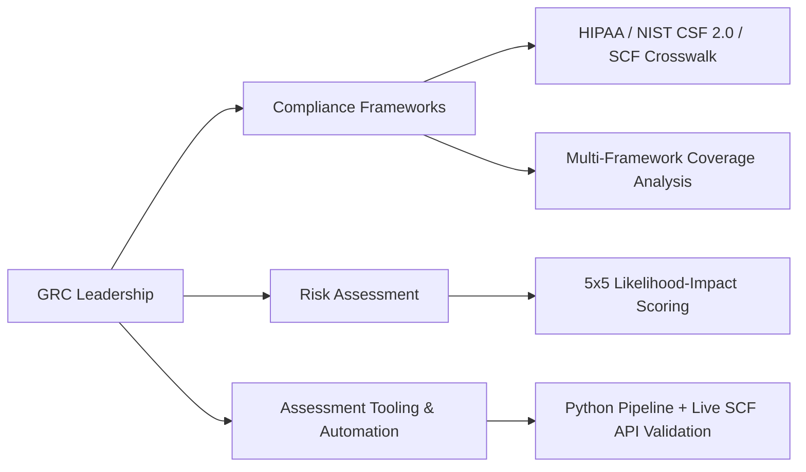

# GRC Professional Portfolio

  <h1>Braxton Croley</h1>
  
<em>GRC & Privacy Compliance Analyst — HIPAA, Multi-Framework Risk Assessment</em>

  

    <strong>Email:</strong> braxton@privacute.com 
    <strong>LinkedIn:</strong> linkedin.com/in/braxton-croley 
    <strong>GitHub:</strong> github.com/Privacute
  

  

    <strong>AWS Cloud Practitioner</strong> |
    <strong>CompTIA Security+</strong> |
    <strong>CISA (In Progress)</strong> |
    <strong>Founder, Privacute</strong>
  

## Professional Overview

GRC and compliance analyst with 5+ years across healthcare, financial services, and other highly regulated environments, specializing in HIPAA privacy and security compliance, multi-framework risk assessment, and audit evidence management. I translate regulatory requirements into actionable, source-verified findings for stakeholders ranging from control owners to executive leadership. I built a working, multi-framework GRC assessment engine from the ground up, validated every control mapping against a live authoritative catalog, and applied it to conduct a full current-state risk assessment. I am also the founder of Privacute, a Maryland-based healthcare privacy consultancy helping small to medium size practices become and stay HIPAA privacy audit-ready.

## Areas of Expertise

<table>
  <tr>
    <td width="33%" align="center">
      <strong>HIPAA & Multi-Framework Compliance</strong> 
      <small>HIPAA Privacy & Security Rule, NIST CSF 2.0, SCF crosswalk mapping</small>
    </td>
    <td width="33%" align="center">
      <strong>Risk Assessment & Scoring</strong> 
      <small>5x5 likelihood-by-impact scoring, evidence-based finding calibration</small>
    </td>
    <td width="33%" align="center">
      <strong>Assessment Tooling</strong> 
      <small>Python pipeline development, live control-catalog API validation</small>
    </td>
  </tr>
  <tr>
    <td width="33%" align="center">
      <strong>Audit & Evidence Management</strong> 
      <small>Evidence validation, control-to-framework mapping, audit liaison</small>
    </td>
    <td width="33%" align="center">
      <strong>Data Governance & DLP</strong> 
      <small>Microsoft Purview, data classification, privacy protection controls</small>
    </td>
    <td width="33%" align="center">
      <strong>Client & Stakeholder Advisory</strong> 
      <small>Plain-language translation of regulatory requirements, cross-functional advisory</small>
    </td>
  </tr>
</table>

## Flagship Project: Multi-Framework GRC Assessment Engine

**What it is**: A self-directed, solo-built Python tool that assesses an organization's security and privacy posture against HIPAA and NIST CSF 2.0, with every control mapping validated in real time against the live Secure Controls Framework (SCF) catalog rather than a static or memorized reference.

**Why it matters**: Most compliance tooling either hardcodes control mappings (which go stale) or trusts human recall of a 1,468-control catalog (which produces errors). This engine does neither — it validates every control ID against the live SCF API before it's allowed into a report, and it halts processing rather than publish an unverified mapping.

**Technical components**:
- Python pipeline that ingests structured findings (JSON), validates every control ID against the live SCF REST API, enriches findings with HIPAA and NIST CSF 2.0 references via the SCF crosswalk, and generates a formatted report
- A validation gate that halts the pipeline and preserves data integrity if any control ID fails verification, rather than silently proceeding with an unverified mapping
- A 5x5 likelihood-by-impact risk scoring model with defined Low / Medium / High / Critical bands, applied consistently across every finding
- A coverage analyzer that measures assessed controls against real framework denominators and explicitly flags NIST CSF functions (Detect, Respond, Recover) with zero coverage — honest coverage reporting rather than inflated percentages
- An AI narrative layer (Anthropic API, swappable mock interface) that drafts plain-language executive summaries from already-verified facts. The AI never determines a control mapping or a risk score — it restates facts that were already computed and verified deterministically, and every AI-drafted claim carries provenance back to its source
- Automated backup and safe-write patterns to prevent data loss during pipeline runs, and parameterization so the tool runs against any assessment dataset without code changes

**Applied to a real assessment**: I used the engine to conduct a full current-state self-assessment of Privacute, my own company. The assessment identified four real findings across device encryption, AI-use governance, data-handling policy, and vendor inventory — each mapped to a verified SCF control, scored honestly (none rated above Medium, an accurate reflection of a small, pre-revenue company with strong technical hygiene and a handful of governance gaps), and used to drive real remediation. The findings and remediation are documented in Privacute's public-facing GRC Program Overview.

**Link**: [example-clinic-grc-assessment](https://github.com/Privacute/example-clinic-grc-assessment) — the engine and a full assessment run against a fictional clinical scenario

## Venture: Privacute

**Overview**: Founder and principal of Privacute, a Maryland-based healthcare privacy consultancy. Privacute gets practices audit-ready on HIPAA privacy and keeps them that way — privacy assessment, gap remediation, evidence and audit-readiness organization, and whole-workforce training (including offshore virtual assistants), all scoped to HIPAA privacy for v1.

**Key design principles I built and enforce**:
- **The attestation wall**: Privacute prepares practices for audit; an independent third party certifies them. Never both. This is a deliberate conflict-of-interest safeguard, not a limitation — a firm that both remediates and certifies creates a credibility problem for the client's insurer or assessor.
- **Honest, current-state claims only**: no company past-performance claims that can't be cited; all credentials attributed to my own background, not invented company history.
- **Right-sized governance**: Privacute's own internal Data Handling & AI-Use Policy and GRC Program Overview document current practice as fact and mark planned controls explicitly as commitments, not implemented state — the same discipline the company sells to clients.

**Links**: [privacute-grc-program](https://github.com/Privacute/privacute-grc-program) — the published self-assessment and program documentation. Company site: [privacute.github.io](https://privacute.github.io/)

## Professional Experience

### GRC / Privacy Consultant | PRIVACUTE | July 2024 – Present

- Lead enterprise PCI-DSS program development, building detection policies and data classification schemas that identify unauthorized sensitive data exposure across cloud and endpoint environments
- Deliver ongoing compliance monitoring and risk reporting for leadership and business owners, documenting threat likelihood, risk impact, and remediation status aligned to NIST SP 800-53 and ISO 27001 standards
- Apply HIPAA privacy and security requirements across healthcare systems, reducing identified vulnerability gaps by 25% through targeted, analytics-driven remediation
- Serve as primary liaison between control owners and auditors during external audit cycles, extracting, validating, and presenting compliance evidence for regulatory requests
- Standardized automated compliance monitoring using AWS, reducing open vulnerabilities by 78% across 10,000+ enterprise assets
- Serve as the primary compliance resource for IT, engineering, Privacy, and Regulatory Affairs stakeholders, translating complex HIPAA, FedRAMP, and NIST requirements into actionable guidance

### Technical Project Manager | CTM | June 2023 – July 2024

- Developed standardized compliance reporting templates, audit evidence tracking workflows, and performance dashboards, reducing audit preparation time by 50%
- Conducted HIPAA compliance gap assessments for healthcare organizations, evaluating existing controls against regulatory requirements and producing structured remediation reports
- Trained AI chat bots on internal business systems and external communication channels increasing customer usage by 45%
- Managed an enterprise GRC database tracking control ownership and compliance performance metrics, producing regular analytical reporting for executive leadership
- Designed and maintained compliance documentation including SSPs, POA&Ms, and BCPs
- Managed client-facing compliance engagements and external audit cycles across healthcare and government environments

### Technical Support Engineer | CTM | November 2020 – June 2023

- Analyzed infrastructure security control data using FISMA standards, producing a 30% increase in compliance monitoring coverage and a 40% reduction in audit findings
- Maintained HIPAA-aligned compliance data records and security documentation in alignment with NIST SP 800-53 and RMF
- Monitored API and network security data across healthcare LAN/WAN environments, collaborating with engineering teams to deliver structured risk reports with remediation recommendations

### Help Desk Agent | EMPLOYER NAME (CONFIDENTIAL) | January 2020 – October 2020

- Delivered HIPAA and NIST 800-53 compliance guidance to healthcare clients, assessing compliance posture and communicating findings with 100% client satisfaction
- Conducted quarterly IAM access reviews and control validations, documenting findings and supporting ongoing access governance

## Professional Credentials

### Certifications
- **AWS Cloud Practitioner** — AWS — December 2024
- **CompTIA Security+** — CompTIA — April 2022
- **Certified Information Systems Auditor (CISA)** — ISACA — In Progress

### Education
- **Bachelor of Business Administration – Finance** — Washington, D.C.

## The Discipline Behind This Portfolio

Every claim in this portfolio is either a verified fact from documented work or explicitly labeled as pending. Where a project is solo and self-directed, it's presented as exactly that — not implied as a team deliverable or enterprise production system. Where a metric came from an employer engagement, it reflects that employer's reporting, not this portfolio's embellishment. This mirrors the standard I hold Privacute to: state only what is true, and label everything else.

## Contact & Engagement

Open to GRC analyst/engineering roles, HIPAA compliance, AI Governance consulting engagements.

  

    <strong>Email:</strong> braxton@privacute.com 
    <strong>LinkedIn:</strong> linkedin.com/in/braxton-croley
  

